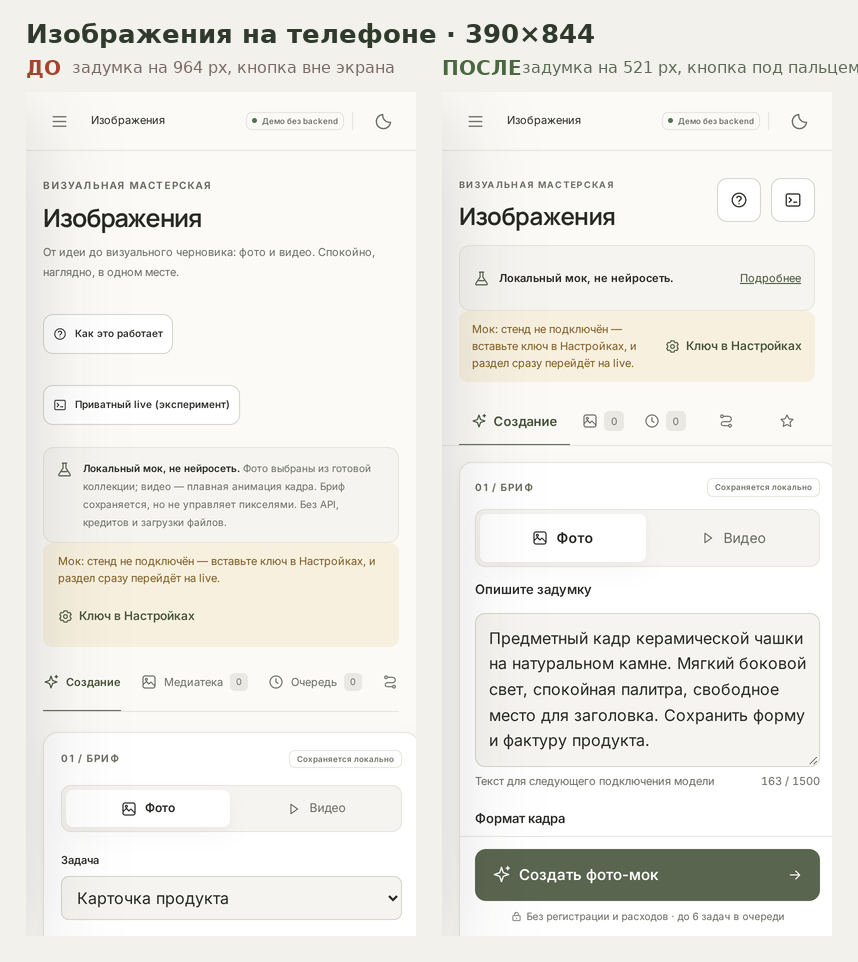

# Мобильный интерфейс: сквозной контракт по всем разделам

Дата: 2026-11-08. Основание: просьба владельца — прогнать мобильные проверки по всем
страницам всех разделов, сделать телефон максимально свободным для творчества и
просмотра своих работ, а служебное и настройки вынести так, чтобы было удобно.
**Веб-версию не менять** — все правки живут внутри `@media (max-width: 650px)`.

## Чем проверяем

`tools/check-mobile-ui.cjs` — один прогон обходит 16 экранов на 390×844 (тач, DPR 2):
главная, диалог, помощники, библиотека промптов, избранное, изображения (5 вкладок),
музыка (5 вкладок), настройки и боковая панель. Собирает все нарушения за раз и
печатает списком; `--report` — аудит без падения, без флага — гейт. Скриншоты каждого
экрана складываются в `BRIIX_TEST_OUT/mobile-ui`. В CI шаг «Mobile UI contract (all
sections)» — блокирующий.

Контракт экрана:

1. нет горизонтального скролла и нет контролов, обрезанных за край (элемент внутри
   ленты с `overflow-x: auto` обрезкой не считается — до него долистывают пальцем);
2. тач-таргеты не меньше 40 px, главное действие — не меньше 44 px;
3. поля ввода не меньше 16 px, иначе iOS приближает страницу при фокусе;
4. главное творческое действие видно без прокрутки, поле творчества не ниже экрана;
5. все вкладки раздела помещаются в экран — спрятанную за краем не находят;
6. axe (wcag2a / 2aa / 21aa) без нарушений.

## Что нашёл первый прогон и что стало

| Экран | Было | Стало |
|---|---|---|
| Главная | 9 мелких таргетов, отправка 33×33, поле на y=462 | 0 мелких, отправка 48×48, поле на y=324 |
| Диалог | 5 мелких, отправка 33×33, продолжения 33 px | 0 мелких, отправка 48×48, продолжения 44 px |
| Помощники | 12 мелких, поиск 11 px | 0 мелких, поиск 16 px |
| Библиотека промптов | 9 мелких, поиск 11 px | 0 мелких, поиск 16 px |
| Избранное | 3 мелких (вкладки 30 px) | 0 мелких, вкладки 44 px |
| Изображения / создание | задумка y=964, кнопка y=1458 вне кадра, 2 вкладки за краем, 9 мелких | задумка y=521, кнопка видна, 5 вкладок в кадре, 0 мелких |
| Изображения / остальные 4 вкладки | вкладки за краем, фильтры 24 px | всё в кадре, фильтры 44 px |
| Музыка | уже соответствует (сделано раньше) | без изменений |
| Настройки | 5 мелких, 6 полей 10–12 px | 0 мелких, все поля 16 px / 48 px |
| Боковая панель | история 37 px | пункты и история 44 px |

Итог: `FINDINGS {}` — контракт держится на всех экранах.

## Принципы, по которым переделан телефон

- **Экран отдан работе.** Приветствие, маркетинговые подзаголовки и длинные пояснения
  убраны с первого экрана; поле задумки и результат — главное, что видит человек.
- **Служебное свёрнуто, а не спрятано.** Пояснение о режиме, детали брифа, тон и темп,
  референсы — в раскрытиях. На десктопе они открыты и читаются как раньше.
- **Честность маркировок сохранена.** «Локальный мок, не нейросеть» видно даже в
  свёрнутом виде, баннеры и бейджи остались; полный текст — по тапу.
- **Главное действие под большим пальцем.** Кнопка создания липнет к низу с учётом
  `safe-area`, поэтому её не надо искать в конце длинной формы.
- **Результат появляется над формой** и сам въезжает в кадр: раньше он оставался под
  длинным брифом и казалось, что кнопка не сработала.
- **Всё под палец.** Таргеты 40–48 px, поля 16 px (iOS не масштабирует страницу),
  вкладки помещаются все и не теряются за краем.
- **Веб не тронут.** Ни одного правила вне мобильного медиа-запроса; палитра прежняя.

## Прогоны

| Сюит | PASS |
|---|---|
| check-demo | 20 |
| check-media | 25 |
| check-music | 29 |
| check-media-live | 12 |
| check-music-live | 17 |
| check-chat-live | 11 |
| check-live-default | 10 |
| check-wait-phrases | 10 |
| check-showcase | 12 |
| check-published-mode | 15 |
| check-mobile-ui | контракт без находок, 16 экранов |

Все exit 0.

## Границы проверки

Проверено в Chromium с тач-эмуляцией на локальной статике и в published-режиме.
Живой Safari на iOS и реальный стенд из песочницы недоступны: липкие панели при
открытой клавиатуре и поведение на устройстве стоит посмотреть глазами после деплоя.
