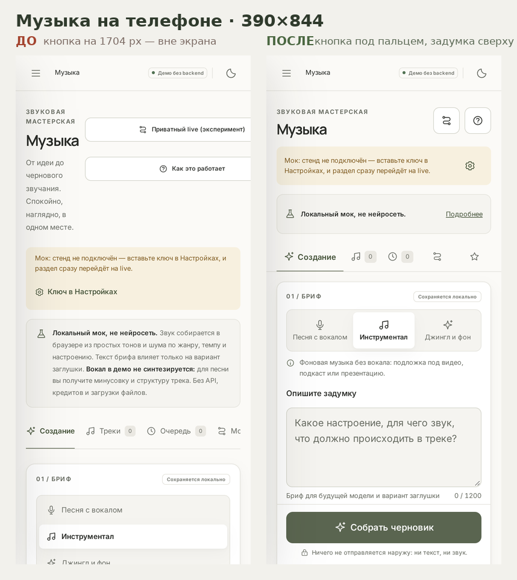

# Музыка на телефоне: 390×844

Дата: 2026-11-08. Основание: жалоба владельца — «с мобильного в разделе музыки почти
ничего невозможно сделать». Радиус: клиент (`music.js`, `music.css`) и тесты.
Сервер не тронут. Палитра не менялась, десктопная раскладка сохранена.

## Что было не так (замеры, а не впечатления)

| Что | До | Почему это блокер на телефоне |
|---|---|---|
| Кнопка «Собрать черновик» | y = 1704 px, вне экрана | 2.5 экрана скролла до главного действия |
| Поле «Опишите задумку» | y = 1124 px | первое поле — ниже первого экрана |
| Кнопки шапки | уезжали за правый край | «Приватный live» и «Как это работает» нельзя нажать |
| Вкладка «Галерея стенда» | за краем ленты, невидима | пятая из пяти не находилась |
| Поля ввода | 12 px | iOS приближает страницу при фокусе и ломает раскладку |
| Результат после отправки | под длинной формой | казалось, что кнопка ничего не сделала |
| Пояснения о режиме | 239 px первого экрана | треть экрана — дисклеймеры |
| Тач-таргеты | 28–42 px | палец промахивается |

## Что стало

| Что | После |
|---|---|
| Кнопка отправки | y = 757 px, видна сразу, 52 px высотой, липнет к низу с safe-area |
| Поле задумки | y = 584 px, первый экран, 16 px кегль, 132 px высота |
| Кнопки шапки | иконки 44×44 в кадре, доступные имена в `aria-label` |
| Вкладки | все пять в 356 px: подпись у активной, иконка и счётчик у остальных |
| Пояснение о режиме | свёрнуто; маркировка «Локальный мок, не нейросеть» видна всегда |
| Вторичные параметры | раскрытие «Тон и темп» (на десктопе открыто) |
| Результат | появляется над формой и прокручивается в кадр (y = 117) |
| Плеер | кнопка 56 px, перемотка 44 px, действия 44 px |
| Тач-таргеты в разделе | ни одного меньше 40 px на всех пяти вкладках |

## Принципы, по которым делалось

Как в музыкальных ИИ-студиях: первый экран отдан задумке, а не описанию продукта;
тип трека — крупные сегменты; главное действие всегда под большим пальцем; результат
показывается сразу и выше формы; вторичные параметры убраны в раскрытие, но не спрятаны
насовсем; поля не мельче 16 px, чтобы мобильный браузер не масштабировал страницу.

Честность маркировок сохранена: свёрнутое пояснение показывает заголовок «Локальный мок,
не нейросеть», баннер и бейдж «Мок» остались на месте, полный текст доступен по тапу.

## Проверки

`tools/check-music.cjs` — 29 PASS, из них 6 новых мобильных:

1. первый экран: кнопка и задумка видны, кнопки шапки не обрезаны, все пять вкладок
   в кадре и не меньше 44 px, кегль поля ровно 16 px, маркировка видна в свёрнутом виде;
2. раскрытия отдают вторичные поля и полный текст режима;
3. на каждой из пяти вкладок нет горизонтального скролла и нет таргетов меньше 40 px;
4. отправленная задача показывается над брифом;
5. кнопка плеера и перемотка под палец;
6. axe на 390 px — без нарушений.

Полный регресс: demo 20, media 25, media-live 12, music-live 17, chat-live 11,
live-default 10, wait-phrases 10, showcase 12, published-mode 15, music 29 —
**161 PASS, все exit 0**.

## Что осталось за рамкой

Живой стенд с телефона не проверялся: из песочницы нет доступа к demo.briix.ru и ключа
стенда. Проверено в мобильном контексте Chromium (тач, deviceScaleFactor 2) на локальной
статике и в published-режиме. Реальный Safari на iOS стоит проверить вручную после деплоя —
особенно поведение липкой панели при открытой клавиатуре.
